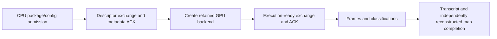

<!-- SPDX-License-Identifier: CC-BY-4.0 -->
<!-- Copyright (c) 2026 Tuomas Pietilä -->

# Maintained native LiDAR runtime architecture

**Developer and project lead: Tuomas Pietilä.** Engineering includes OpenAI Codex
assistance. This description is grounded in implementation commit
`b1bfebea38c0cad651710a964401f7b86dc1bebd`; each qualification result has its own
source, environment, model, data and configuration identity.

The maintained runtime separates model admission, original-point inference,
transport, map state and output preservation. Native classification uses C++17,
CUDA and TensorRT; Python supplies development, independent verification and
scientific evaluation tooling. A CPU build supports package inspection, geometry,
codecs, maps, source decoding and tests. Its production backend rejects inference.
The opaque CPU backend exists only in test executables and is never installed.

The [previous architecture](archive/history/ARCHITECTURE_PRE_RUNTIME_R3.md) is
preserved byte-for-byte. It records the earlier SegFormer product and historical
BYOM additions, including their narrower deployment and preservation contracts.
Its internal relative links retain their original repository-root context; use
the maintained links here for current navigation. Its diagrams, model dimensions,
Jetson measurements and relocation results are historical evidence, not a
specification or qualification of the generic runtime below.

## Entry points and reproduction

Use the [maintained CPU checks](docs/CPU_CHECKS.md) for the complete Release and
ASan/UBSan build, CTest, pytest, installation, style and inventory workflow.
The [native quickstart](docs/byom/QUICKSTART.md) supplies dependency and
CUDA/TensorRT build commands. The [SDK reproduction guide](docs/streaming/STREAMING_R2_REPRODUCIBILITY.md#native-gpu-correctness-and-transport)
records a historical RTX SDK setup and command shapes; select and record the
actual compiler, headers, linked/runtime libraries and target for a new build.
Historical version strings and engine packages do not establish compatibility
with a different target or qualify newly changed source.

| Interface | Purpose and contract |
| --- | --- |
| `synrex-native` | Package, inspect, plan, build an engine and classify supported files; [dense adapter](docs/byom/ADAPTER.md), [explicit packages](docs/byom/PACKAGE_V3.md) |
| `synrex-generic-live receive/send/subscribe` | Explicit generic descriptor, readiness and output completion; [single-file producer/receiver/subscriber guide](docs/streaming/GENERIC_SINGLE_FILE_V3.md) |
| Same generic commands with `--manifest` | Finite, source-ordered multi-file replay; [manifest guide](docs/streaming/DISTINCT_REPLAY.md) |
| `synrex-replay inspect` | CPU manifest/source admission and bounded decode; no classification |
| Legacy streaming executables | Retained package-v2 and legacy wire/text contracts; [legacy runtime commands](docs/streaming/STREAMING_R1_RUNTIME.md) |
| `synrex-laz-labels` | Apply supplied LAS classification bytes without inference; [label-writer guide](BRING_YOUR_OWN_MODEL.md) |

## Model and semantic identity

The common adapter is `DENSE_VOXEL_SEGMENTATION_V1`: one static batch-one dense
input and one per-voxel score output in contiguous NCZYX order. It admits 1–32
ordered features and 2–256 output channels, with declared float32/float16 I/O,
geometry, complete channel-to-LAS projection and resource limits. Actual engine
tensors must match the contract. Dynamic shapes, sparse/point-transformer
adapters, extra tensors and user plugins are outside this interface.

Package-v2 retains its existing file behavior and legacy streaming restrictions.
Legacy synthetic/FRACTAL taxonomy handling is a separate, explicitly limited
contract; a seven-channel count does not identify FRACTAL meanings. Legacy
endpoints reject package-v3 before expensive initialization. Wire-v2 receives
no new generic startup handshake and never silently falls back from a generic
wire selection.

[Package-v3](docs/byom/PACKAGE_V3.md) adds exact
[taxonomy bytes](docs/byom/TAXONOMY.md) and their hash. Ordered semantic channels,
class meanings and LAS codes remain separate: different semantic classes may
project to the same LAS byte, and channel 255 is valid at K=256. Reusing a taxonomy
name, class count or LAS projection cannot establish semantic identity.
Package envelope, dense adapter, taxonomy, context policy, descriptor and binary
wire schemas carry distinct identities. Generic text streaming is unsupported.

CPU admission captures the exact manifest, taxonomy, contract and hash-verified
model bytes in a privately owned [engine artifact](docs/byom/ENGINE_ARTIFACT.md).
Execution uses those retained bytes rather than reopening a model pathname after
peer admission. Captured engine bytes remain host memory throughout the session;
that retention belongs in resource accounting. Hashes bind bytes to a trusted
manifest; they are not a signature, model provenance proof or hostile-model sandbox.

## Admission precedes execution readiness

The [generic startup gate](docs/byom/GENERIC_STARTUP.md) and
[transport](docs/byom/GENERIC_TRANSPORT.md) enforce this sequence:

The peer acknowledges metadata before inference initialization or the first
classified frame. Metadata admission has an absolute five-second deadline;
initialization/readiness has its own selected absolute deadline. Fragmentation
and polling do not restart either timer. The authority factory checks completion
of actual backend construction and identity before returning a usable Session.
Synchronous vendor initialization cannot be preempted: an overdue result is
destroyed and cannot become ready.

The CLI uses separate input and output connections. Both metadata admissions and
identical negotiated descriptors precede one backend construction; both readiness
exchanges precede frames. Session, descriptor, epoch, taxonomy and source identity
remain bound throughout execution. Errors poison the affected session/connections;
a new model, policy or epoch requires a new session. This loopback transport is
not authenticated remote access or a resumable multi-producer service.

Binary-v3 uses bounded SRX3/version-3 envelopes. Manifest replay can explicitly
select [binary-source-v1](docs/byom/SOURCE_FIDELITY.md), using SRXS/version-1 and a
descriptor-bound source-attribute schema. It adds exact public-header bytes, raw
integer XYZ, scales/offsets, source row identity and opaque GPS bits to supported
point attributes. The variant admits standard PDRF6/7/8 record lengths; unknown
extra record attributes reject. It does not transport RGB/NIR, all VLRs or the
complete LAZ record. Raw GPS bits never become an acquisition clock implicitly.
Protocol selection is explicit; descriptors and completion hashes prevent mixing
variants after admission.

## Geometry, inference and original-point reconstruction

File input is already georeferenced, supported compressed LAS 1.4 PDRF6/7/8.
The [checked laz-perf overlay](docs/streaming/LAZPERF_OVERLAY.md) is generated in
the build directory from pinned upstream bytes; it preserves external dependency
ownership and notices. Decoding establishes declared-record coverage under the
supported layout, not arbitrary physical EOF or malicious-file safety.

The [adapter contract](docs/byom/ADAPTER.md) defines source-minimum block origins,
half-open membership, voxel flooring and lexicographic block order. Coincident
points remain separate original records. Features include occupancy, count, mean
intensity and mean local coordinates, with declared normalization. CUDA reductions
use ordered source indices; empty tensor cells remain zero. Argmax ties select
the lowest channel. The declared `first_wins`/`last_wins` overlap policy controls
source-index scatter; no hidden confidence fusion or smoothing is introduced.
Every original point must receive a valid semantic result and exact LAS projection.

The persistent backend retains the TensorRT context, CUDA stream and reusable
buffers across windows. CPU package/capacity checks precede CUDA-owning members;
actual target, tensor and device-memory checks remain required at initialization.
Engine building is explicit and separate from classification. TensorRT 10.x and
target-specific engine bytes are part of the native SDK contract; an FP16 tactic
policy does not change declared tensor I/O types or establish numerical parity.

Generic execution uses the versioned current-frame policy: no history, a separate
minimum per window, and current points emitted once. The semantic map consumes
completed classifications; it does not supply cached labels or historical model
context. Alternate geometry strategies and CPU differential/profile tools do not
by themselves establish a GPU optimization benefit or permission to change the
admitted preprocessing contract.

## File boundaries, distinct replay and terminal output

The [single-file CLI](docs/streaming/GENERIC_SINGLE_FILE_V3.md) binds a sealed
source capture and local zero-based row IDs. Its optional subscriber exporter
checks source, taxonomy, descriptor and complete row coverage. Only after output
completion does it encode preserved LAZ and publish a new bundle without replacing
existing output. All nonclassification point-record bytes remain under the
[writer's supported preservation boundary](BRING_YOUR_OWN_MODEL.md). Compressed
file bytes can change. Atomic publication requires the applicable Linux filesystem
operations; it is not a power-loss durability guarantee.

[Manifest replay](docs/streaming/DISTINCT_REPLAY.md) instead identifies each record
by `(source SHA256, original row index)` and uses checked global wire-ID prefixes.
Duplicate source hashes cannot add distinct observations; physical points across
different files are not deduplicated. Decode windows are bounded, with at most two
queued windows plus caller/decoder buffers. Every file gets a fresh descriptor
epoch, session and map under `reset_each_file`. EOF partial windows are retained.
Files are consumed once in manifest order, with verified partial failures visible.
The source catalog and receipt roster scale with admitted source count. A manifest
trial's global IDs never enter the local-row preservation exporter: multi-file
preservation export is explicitly unsupported.

Input completion binds exact encoded frame hashes and counts; producer PASS means
acknowledged input delivery. Output completion additionally binds classification
and final-map hashes, independent subscriber reconstruction, fresh challenges and
EOF fences. Socket writes or EOF alone cannot qualify the whole pipeline.

## Map state, timing and accounting

Maps retain a bounded last-accepted-observation state with revision/eviction
ordering. Older updates to an existing cell reject; equal timestamps retain the
specified recency behavior. There is no TTL expiry or calibrated confidence.
Generic snapshots/deltas bind the full descriptor and preserve semantic IDs even
when LAS codes coincide. Both legacy and generic live snapshot capacities are
1–65,536 cells with final encoded-byte checks. Their schemas and admission proofs
are separate: [legacy budget](docs/streaming/SNAPSHOT_BUDGET.md),
[generic maps and completion](docs/byom/GENERIC_RUNTIME.md).

[Manifest timing](docs/streaming/REPLAY_TIMING.md) reports fixed-memory histograms
per source and merged trial populations, with interval-valued quantiles and named
process-local boundaries. Decode, assembly, pacing lag, ingress, receiver service
and independent subscriber validation remain distinct. Receiver service excludes
accumulation, ingress wait and subscriber validation; overlapping GPU stages are
not summed into wall latency. Whole-process RSS and CPU time have their own scope.

Synthetic accumulation is separate from physical point age. At 40,000 points/s,
a 16,384-point window requires about 409.6 ms of accumulation before processing.
A short service time cannot establish 250 ms capture-to-output age for that policy.
Unknown acquisition timing and missing power provenance stay unavailable. Finite
emission rate, distinct record coverage and repeated-input legacy throughput are
different measures. Optional instrumentation pairs retain identical output hashes
and signed timing differences; CPU fixtures do not qualify actual GPU overhead.
Owned execution uses source/input/environment identities and the established
resource lease; see [job receipt boundaries](docs/runtime_jobctl.md).

## Quality, comparison and evidence boundaries

The [Q0/Q1 evaluator](docs/streaming/QUALITY_EVALUATION.md) separately freezes
whole-source Q0, unchanged 16,384-point independent-window Q1, original-point
coverage and matched reference/native output identities. Numerical implementation
parity, semantic policy quality and system capacity are separate verdicts. The
scorer performs no inference. Prefix/cutoff probes and policy names require
execution provenance; a final map cannot replace timely original predictions.

[Runtime comparison](docs/runtime_comparison.md) scores explicit original-point
label streams and class mappings. [Acquisition uncertainty](docs/runtime_uncertainty.md)
keeps paired statistical units separate from point count.
[Representation diagnostics](docs/runtime_representation.md) characterize truth
collisions, boundaries and optional annotated thin structures at selected grids:
majority labels maximize fixed-partition accuracy, not an mIoU upper bound or a
deployable classifier. [Retained-sidecar rescoring](docs/runtime_sealed_outputs.md)
consumes historical semantic vectors without rerunning inference. It does not
create a fresh holdout or current-source Q0/Q1 evidence. Ground-class metrics are
classification proxies, not DTM vertical accuracy without external terrain truth.

| Capability/evidence | Current boundary |
| --- | --- |
| Package/descriptor admission, codecs, sockets, maps, completion, preservation and scorers | Executed CPU contract/regression fixtures; opaque classes establish mechanics only. Exact candidate acceptance belongs to source/binary-bound receipts and the complete CPU workflow. |
| Generic package-v3 file/stream execution on actual TensorRT/CUDA | **NOT_RUN** for this maintained generic path; CPU fixtures and SDK compile checks cannot establish GPU interchangeability. |
| Trained current-source Q0/Q1 quality, causal execution and finite/distinct GPU capacity | **NOT_RUN**; evaluator implementation and retained historical predictions do not replace required execution. |
| Frozen legacy RTX4090 U-Net file/stream/repeated-tile results | Historical, scene/model/source-specific; [R1 qualification](docs/streaming/STREAMING_R1_QUALIFICATION.md), [R2 audit](docs/streaming/STREAMING_R2_AUDIT.md), [whole-tile model evaluation](docs/byom/UNET_R2_RELEASE.md). No transfer to the generic path or Q1 quality. |
| Earlier SegFormer/Jetson file product | Separate [historical architecture](archive/history/ARCHITECTURE_PRE_RUNTIME_R3.md) and [benchmark](archive/history/BENCHMARK.md); no current streaming/Orin qualification. |
| Physical sensor, UAV capture, AGX/Thor generic deployment and terrain accuracy | **NOT_RUN**; no inherited device, acquisition or terrain claim. |

Historical negative rate/latency trials, decoder failures and unsupported layouts
remain part of their evidence. Neither this architecture rewrite nor a later
source commit turns them into successful measurements. New generic qualification
must bind one integrated source, SDK/environment, model/engine, data and policy;
retain raw disagreement and failure receipts, then obtain independent review.

Original native code is MIT where scoped; original documentation is CC BY 4.0.
Models, data, patched upstream code and vendor SDKs retain their own rights and
notices. See [license scope](LICENSE_SCOPE.json), [third-party notices](THIRD_PARTY_NOTICES.md)
and [design provenance](docs/byom/PROVENANCE_REVIEW_R1.md).
