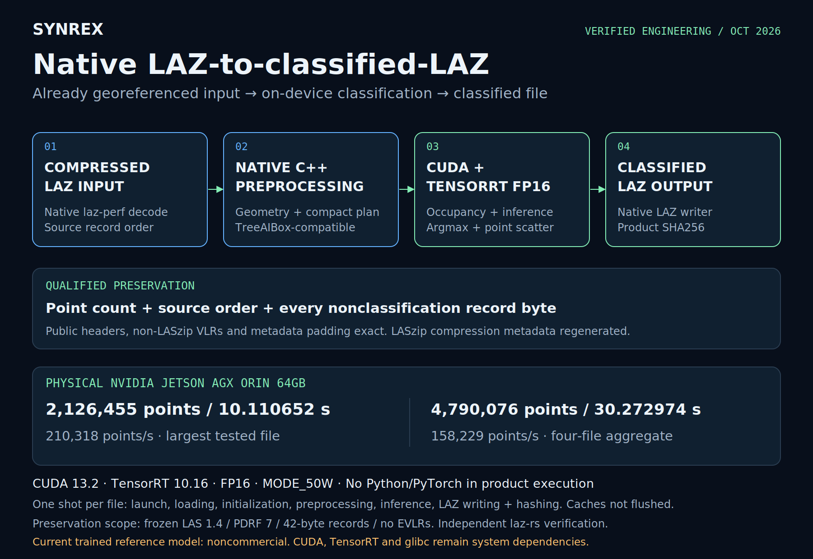

# Native architecture and release boundaries

<!-- Copyright (c) 2026 Tuomas Pietilä. SPDX-License-Identifier: CC-BY-4.0. Original expression only; upstream material and facts excluded. -->

**Developer and project lead: Tuomas Pietilä ([@Juurikko](https://github.com/Juurikko)).**

**Native BYOM R0 addition:** `native/` implements a generic package-driven pipeline, linking the retained MIT writer. Read the [adapter specification](docs/byom/ADAPTER.md), [build/usage guide](docs/byom/QUICKSTART.md) and [physical RTX4090 qualification](docs/byom/RTX4090_QUALIFICATION.md). Its regular 3D block geometry and NCZYX feature contract differ from the private SegFormer semantics described below; [provenance review](docs/byom/PROVENANCE_REVIEW_R1.md) records the design relationship. RTX4090 GPU execution is qualified on the original fixture; physical AGX qualification remains NOT_RUN. Historical qualification does not transfer to this source.

The verified product boundary begins with an **already-georeferenced compressed LAZ file** and ends with a classified LAZ plus product digests. Sensor acquisition, georeferencing and a live telemetry service are outside that measurement.

[Landscape SVG](media/pipeline-landscape.svg) · [Portrait SVG](media/pipeline-portrait.svg)

These diagrams are the accepted publication graphics, copied without alteration. The four boxes group a more detailed implementation described below.

## 1. Package and target gates

The native C++ product launcher verifies host/target contracts, component identities, the model package's internal SHA256 manifest, tensor/preprocessing contracts and reference-license opt-in. A package contains the qualified target engine and lineage/configuration artifacts. These packages are excluded here.

The Product Runtime R1 installation resolves bundled libraries relative to the executable using `$ORIGIN/../lib`, clears inherited `LD_LIBRARY_PATH` and does not depend on historical build paths. A relocated copy was qualified outside the original build tree with invalid competing bundle-library files on `LD_LIBRARY_PATH`. CUDA, TensorRT and glibc remain system dependencies. This is relocation qualification on the tested target, not engine portability across devices.

The launcher executes native inference and classified-LAZ components, requires expected artifacts and hashes labels and final LAZ. Contract failures, component failures or missing products cause the command to fail. The full execution measurement includes wrapper initialization and package checks; an inference-service internal timer is a different boundary.

## 2. laz-perf decode and native geometry

[laz-perf 3.4.0](https://github.com/hobuinc/laz-perf/tree/b7bbe26109dc986f42d4fc80b8de3d2b6ca634ce) decodes the source records. The geometry path extracts scaled coordinates for planning; the original record stream remains the authority for file output. Classification does not rewrite coordinates or georeference the file.

The reviewed model contract uses 112 × 112 × 256 voxels, resolution 0.3 × 0.3 × 0.2 metres, horizontal block extent 33.6 × 33.6 metres and 10% overlap, with a 30.24-metre horizontal stride. Per-block voxel coordinates follow `floor((xyz - block_min_xyz) / resolution_xyz)`. The native implementation matches the frozen TreeAIBox-compatible grouping and boundary semantics rather than substituting a generic grid.

A compact plan maps source point IDs to occupied voxel IDs. Same-block duplicate destinations are removed only after proving their references resolve to the same occupied voxel, retaining first occurrence order. This avoids competing GPU writes without changing the qualified mapping. Blocks execute sequentially; **later blocks win** where source points participate in overlapping blocks. These are frozen deployment semantics, not a claim that averaging or confidence fusion has been implemented.

## 3. GPU occupancy and TensorRT inference

CUDA builds dense binary occupancy from the sparse occupied-voxel list. Planning indices are XYZ-flat (`((ix * 112) + iy) * 256 + iz`); the GPU converts them to the network's NCZYX spatial layout. The qualified input is float32 `[1, 1, 256, 112, 112]`, the output logits are float32 `[1, 8, 256, 112, 112]`, and the TensorRT engine uses FP16 internally. An FP16 engine does not mean the public tensor interfaces are FP16.

TensorRT context/engine and relevant buffers are reused within a file execution. Every benchmark file still launches a new product process and includes initialization. No always-warm streaming service throughput is inferred. The configured class metadata has seven classes while the network has eight output channels; raw qualified class-ID semantics are retained without inventing a remapping.

## 4. GPU reconstruction and point scattering

CUDA evaluates argmax at occupied voxels. Strict `>` comparison keeps the first class on ties. The inverse voxel map and compact source-index references scatter uint8 labels into original point-ID positions. Sequential block execution preserves the chosen overlap rule. Bounds/capacity checks and frozen output digests support correctness; this is not confidence estimation or semantic-map generation.

## 5. Native classified-LAZ output

The benchmark writer reads the source in order, replaces classification byte 16 of each qualified 42-byte PDRF-7 record, and re-encodes the record. All other decompressed bytes, including coordinates, flags, GPS time, RGB and Extra Bytes, remain intact. It retains the source public header, non-LASzip VLRs and padding while regenerating the compression VLR. Rebuilt compression-stream/chunk-table offsets must agree with the preserved point-data offset.

The production qualification is narrow: LAS 1.4, PDRF 7, 42-byte records, 375-byte public header, point offset 1111, two VLRs, zero EVLRs. It does not establish support for arbitrary LAS formats, EVLRs, waveform packets or COPC indexes. See [validation](VALIDATION.md).

## The runnable public-focused preservation utility

`src/preserve_laz.cpp` implements this separable integrity problem for trusted synthetic/test inputs. It applies **supplied labels**, not a model. It is newly written for this staging release after design/source review, not represented as clean-room work or as the frozen production source/binary. No production preprocessing, inference code or model artifacts are copied into it.

Its prefix parser rejects unsupported versions, formats, record lengths, waveform/EVLR fields, COPC metadata, invalid VLR counts and truncated/oversized prefixes. It permits a variable number of ordinary VLRs/padding within a bounded 16 MiB prefix, unlike the narrower original fixture contract. Its synthetic tests do not expand the historical production qualification.

The utility streams source records and label bytes to laz-perf, then rebuilds a result using the exact source prefix with only the generated compression VLR substituted. Equal physical VLR size is mandatory. The absolute LAZ chunk-table pointer is relocated when the generated and preserved point-data offsets differ. The remaining compressed chunks and table are copied directly.

Only an invocation-local, same-parent scratch directory is used. After all writes close successfully, hard-link creation publishes the staged file without replacing an existing pathname. This requires same-filesystem hard-link support. On failure, only that new scratch directory is removed; the source, labels and existing output remain untouched. This is atomic pathname creation after close, **not a power-loss/fsync durability guarantee**. Inputs must remain immutable during execution. The utility is not a hardened parser for hostile files or a general LAZ repair tool.

The independent Python verifier is offline test tooling; it does not contradict the no-Python/PyTorch requirement of the deployed inference product. Third-party codec sources are fetched externally at the pinned commit and retain Apache-2.0 notices.
