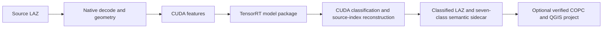
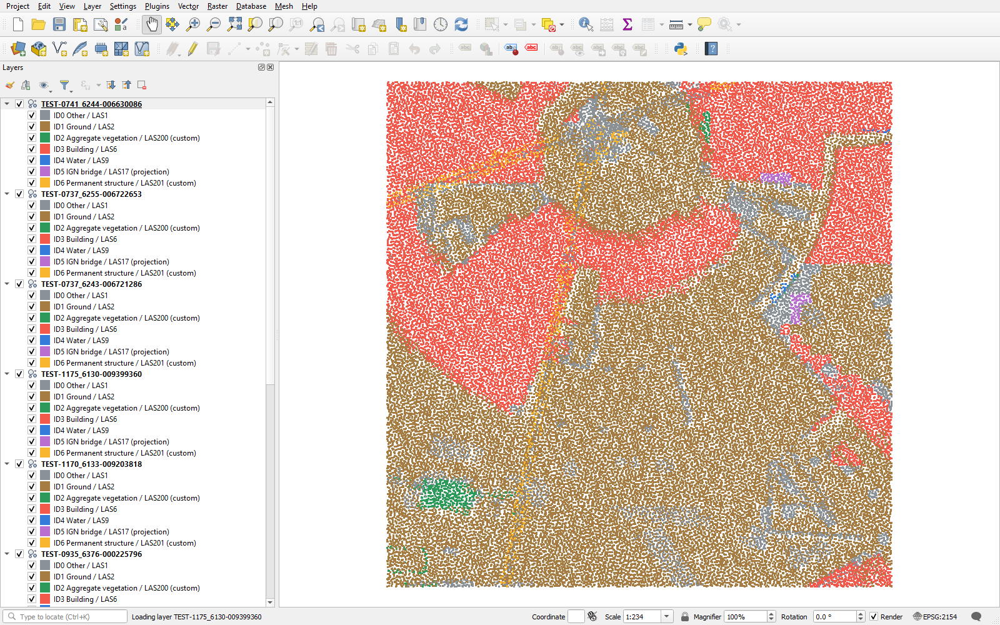

# SynRex Native LiDAR BYOM

<!-- Copyright (c) 2026 Tuomas Pietilä. SPDX-License-Identifier: CC-BY-4.0. Original expression only; upstream material and facts excluded. -->

**Native C++ / CUDA / TensorRT classification, with interchangeable model packages.**
Developer and project lead: **Tuomas Pietilä** ([@Juurikko](https://github.com/Juurikko));
AI-assisted engineering with OpenAI Codex. Local R4 candidate; publication awaits owner approval.

Already-georeferenced LAZ → configurable dense voxels → user model → original-point
predictions → metadata-preserving classified LAZ. The classification executable requires
no Python or PyTorch. Python supports training, independent verification and the optional
QGIS export workflow.

Two genuine models use the **same executable and DENSE_VOXEL_SEGMENTATION_V1 adapter**:

| Model | Purpose | Qualification |
|---|---|---|
| Original analytic Conv3D | Reproducible, deterministic nonconstant integration reference | Real TensorRT/CUDA, 50,013-point LAZ and independent preservation checks |
| Compact trained 3D U-Net | Seven-class airborne LiDAR segmentation | Frozen 256-tile FRACTAL test; 24,902,618 points; real native FP16 predictions |

The U-Net has 62,103 parameters and MIT-attributed pytorch-3dunet architecture. Its four
inputs are occupancy, point count, local height and intensity. Source classifications,
reference labels and aerial imagery are excluded from inference inputs. This runtime
supports its explicit dense-voxel contract; sparse transformers require a separate adapter.

| Accepted RTX 4090 measurement | Result |
|---|---:|
| Seven-class native FP16 point mIoU | **48.756%** |
| Macro-F1 / overall accuracy | 60.585% / 90.814% |
| FP16 vs PyTorch FP32 label agreement | 99.9682% |
| Complete four-scene throughput | **237,991 points/s** |
| Complete boundary | Cold process launch to exit, including LAZ input/output |

[Full performance table and measurement limits](docs/byom/PERFORMANCE_R3.md) ·
[frozen test and per-class quality](docs/byom/UNET_R2_RELEASE.md).
Rare-class quality remains limited; this is a bounded engineering model, with no general
survey accuracy claim. Physical AGX Orin execution is **NOT_RUN** because Spatial Lab's
allocation is reserved. Historical SegFormer AGX measurements used different hardware,
model, data and methodology and are **not a controlled model comparison**.

**Open the release showcase:** extract the release archive and open
`qgis/ready/synrex-fractal.qgz` in QGIS. Ten genuine scenes contain 1,062,717 points,
all seven observed semantic classes and source-indexed COPC views. Original classified
LAZ files and model-bound semantic sidecars remain alongside the viewing derivatives.

Screenshot: actual QGIS desktop; IGN FRACTAL geometry under Etalab 2.0, original presentation
CC BY 4.0 Tuomas Pietilä; QGIS/Qt interface retains upstream rights. Colours show model
predictions, including mistakes. [One-command export and QGIS diagnosis](docs/byom/QGIS_R4.md).

Build from this public source and public dependencies using the
[clean reconstruction instructions](docs/byom/RECONSTRUCTION_R4.md).
Then follow the [two-model release quickstart](docs/byom/RELEASE_R4.md),
[synthetic Conv3D commands](docs/byom/QUICKSTART.md) or
[frozen trained U-Net commands](docs/byom/UNET_R2_QUICKSTART.md).
Compatible models switch by changing `--model`, without recompiling the runtime.
TensorRT engines must match the target; the included RTX plan is not a Jetson plan.

Original qualified software is **MIT**, bounded by [LICENSE_SCOPE.json](LICENSE_SCOPE.json).
Model architecture, learned weights, NVIDIA artifacts, IGN data, documentation and
screenshots have explicit separate scopes: [third-party notices](THIRD_PARTY_NOTICES.md),
[model/data/weight provenance](docs/byom/UNET_PROVENANCE.md),
[preprocessing provenance review](docs/byom/PROVENANCE_REVIEW_R1.md).
Restricted TreeAIBox/SegFormer source and models are excluded; no clean-room claim is made.

Supported native input: compressed LAS 1.4, PDRF 6/7/8, standard 375-byte header,
qualified Extra Bytes, no EVLR/waveform/COPC input. The current classifier holds a cloud
in memory. QGIS 3.44.14's direct reader rejects tested 48-byte files; the independently
verified COPC export avoids that reader lifecycle failure. QGIS is an optional external
application, separately licensed. No aerial georeferencing, streaming or sparse-model
compatibility is claimed.

[Release notes, identities and reproduction](docs/byom/RELEASE_R4.md) ·
[technical showcase](docs/byom/PUBLIC_SHOWCASE_R4.md) ·
[separate future milestones](docs/byom/FUTURE_MILESTONES_R4.md) ·
[retained historical public README and media](README_HISTORICAL.md).

No public push, release upload or visibility change has been performed for this campaign.
