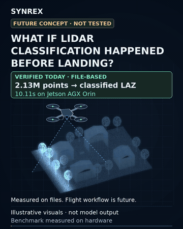
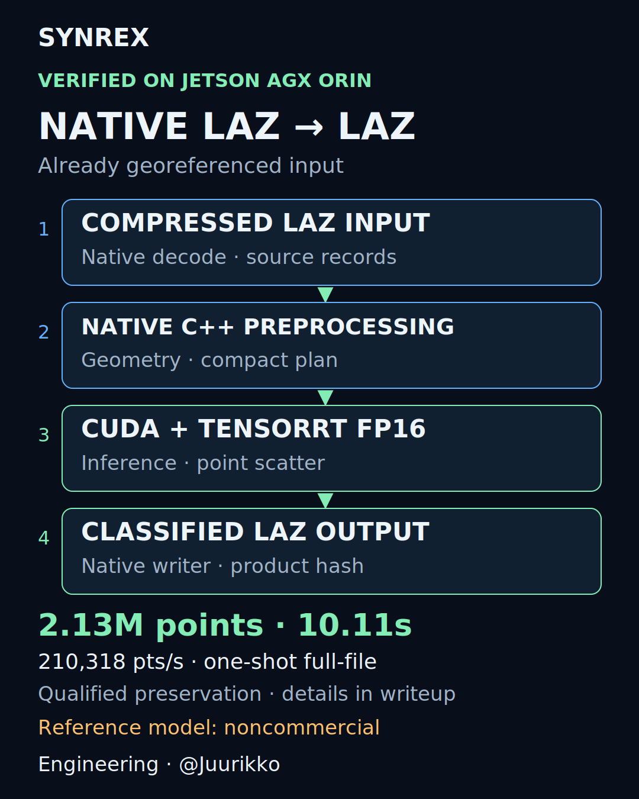

# SynRex · Native LiDAR classification on Jetson

<!-- Copyright (c) 2026 Tuomas Pietilä. SPDX-License-Identifier: CC-BY-4.0. Original expression only; upstream material and facts excluded. -->

**Developer and project lead: Tuomas Pietilä ([@Juurikko](https://github.com/Juurikko)).**

**Already-georeferenced LAZ → native C++ / CUDA / TensorRT → classified LAZ.**

**Native BYOM MIT R0 — local release candidate:** this branch now includes a generic dense-voxel native runtime, CUDA feature preparation/reconstruction, TensorRT 10 execution, versioned model packages and an original synthetic Conv3D ONNX exporter. [Build and BYOM quickstart](docs/byom/QUICKSTART.md) · [adapter specification](docs/byom/ADAPTER.md) · [source/license assessment](docs/byom/PROVENANCE.md) · [current qualification](docs/byom/QUALIFICATION.md).

**Second genuine model: trained MIT U-Net on real FRACTAL LiDAR.** Both models execute
through the same unchanged runtime binary. On the fixed 32-tile held-out pilot
(2,586,115 points), the FP16 U-Net reaches 91.10% point accuracy and 82.08% mean
IoU for ground/vegetation/buildings; bridge IoU is zero and water has no test support.
All original point identities, unrelated bytes and metadata pass independent
laz-rs validation. RTX4090 full suite: **62 passed, 1 CPU-only test skipped**.
[Results and genuine classified examples](docs/byom/UNET_QUALIFICATION.md) ·
[reproduce training/packaging](docs/byom/UNET_QUICKSTART.md) ·
[source/data/weight rights](docs/byom/UNET_PROVENANCE.md) ·
[separate LitePT and existing TorchSparse work](docs/byom/LITEPT_SPARSE_PLAN.md).
Data/examples remain IGN Etalab-2.0; runtime and original learned parameters are MIT
with separate notices. AGX execution is NOT_RUN. Publication remains held.

**RTX4090 physical BYOM qualification now passes:** original ONNX export, native SM89 build, genuine TensorRT engine/inference and CUDA reconstruction produce independently verified, repeated classified LAZ for **50,013 points**. The full target suite has **55 passed, 1 CPU-only test skipped**. [RTX4090 evidence and separate phase timings](docs/byom/RTX4090_QUALIFICATION.md). **Physical AGX qualification remains NOT_RUN**; its [separate plan](docs/byom/AGX_QUALIFICATION_PLAN.md) is prepared and the autopilot is untouched. This branch is not pushed or published. Original runtime source is MIT; dependencies and user models keep separate licenses. The existing MIT writer/verifier are retained, and uncertain private model-dependent source and restricted assets are excluded.

**Historical private SegFormer measurements, not BYOM R0 results:** on a physical **NVIDIA Jetson AGX Orin 64GB**, that pipeline processed **2,126,455 points in 10.110652 seconds: 210,318 points/s** on the largest tested file. Across four files, it processed **4,790,076 points in 30.272974 seconds: 158,229 points/s aggregate**. These were one-shot full product executions, including initialization and classified-file output.

[](media/synrex-jetson-lidar-r1.mp4)

**Engineering: Tuomas Pietilä · AI-assisted with OpenAI Codex.** [Presentation credits and accepted-video attribution](media/PERSONAL_CREDITS.md).

[Watch/download the 30-second MP4](media/synrex-jetson-lidar-r1.mp4). 1080 × 1350, 30 fps, silent. The survey geometry is original illustration, **not genuine model predictions**. Green sections describe verified engineering; amber drone sections are future concepts. Some GitHub views link rather than autoplay relative MP4 assets; the GIF supplies an embedded preview. It is a 9-second excerpt at 360px width/6 fps; the full accepted MP4 remains unchanged.

## Historical SegFormer demonstration

The native product accepts a compressed, already-georeferenced point-cloud file, builds the model's geometric/voxel representation, performs GPU inference, scatters class IDs back to source points and writes a classified LAZ. It preserves source point order and all other point-record data within the qualified file contract. It does not perform sensor georeferencing.

The deployed product requires **no Python or PyTorch runtime**. It still depends on CUDA, TensorRT, glibc and its bundled native libraries. Its existing trained reference model is **TreeAIBox-derived and noncommercial**; this project does not introduce a new neural architecture or establish commercial rights to those weights.

| Measured boundary | Result |
|---|---:|
| Largest tested file | 2,126,455 points / 10.110652 s |
| Largest-file throughput | 210,318 points/s |
| Four-file total | 4,790,076 points / 30.272974 s |
| Four-file aggregate throughput | 158,229 points/s |

**Scope:** MODE_50W, CUDA 13.2, TensorRT 10.16, FP16; one process per file, no warmups/repetitions, normal OS caching. This is not sustained streaming, an in-flight demonstration, a flight-to-map measurement, a state-of-the-art claim or a world record. See [benchmark protocol and all four results](BENCHMARK.md).

## What this repository contains

The current local candidate contains:

- Configurable `DENSE_VOXEL_SEGMENTATION_V1` native source, SHA256-verified model packages, CUDA kernels, TensorRT engine building/execution and an original deterministic Conv3D exporter. Classification requires a compatible NVIDIA target and a user-supplied or locally built engine.
- A substantive C++ LAZ preservation utility that applies supplied uint8 labels while retaining the source header, non-LASzip metadata, padding, point order and all other record bytes.
- An independent **laz-rs** verifier, deterministic synthetic data generator, the original 19 preservation tests, CPU adapter/package integration tests and opt-in physical GPU integration tests.
- Architecture, numerical-validation findings, qualified benchmark receipts and the accepted R1 media.

The retained public-focused writer **is not the frozen writer binary measured in the historical benchmark**. No private model-specific implementation, restricted weights, frozen ONNX/engine or dataset is included. The original synthetic fixture can be exported from source. Historical throughput cannot be reproduced from this generic runtime and is not a claim for it. [BYOM provenance](docs/byom/PROVENANCE.md) explains the current boundary; [publication rights](PUBLICATION_RIGHTS.md) retains the earlier release assessment.

**Existing public baseline — 2026-10-26 (BYOM branch unpublished):** this repository is public at [Juurikko/synrex-jetson-lidar-edge](https://github.com/Juurikko/synrex-jetson-lidar-edge). **PUBLIC_GITHUB_RELEASE=PASS · PUBLIC_VISIBILITY=VERIFIED.** Initial public commit: [`4405474`](https://github.com/Juurikko/synrex-jetson-lidar-edge/commit/4405474c73c25b8c19a5c3bf1b2d70fe30ed6d73). This dated status supersedes earlier staging-only statements; historical audit reports and evidence are retained. Personal developer/project-lead attribution is Tuomas Pietilä. **MIT** applies to the confirmed personally controlled original source/tests; **CC BY 4.0** applies to the original documentation, diagrams and video. Copyright (c) 2026 Tuomas Pietilä applies only to protectable original expression within that scope; factual records and upstream material are excluded. [License scopes](LICENSE_SCOPE.json). See [personal attribution and licensing](PERSONAL_ATTRIBUTION_AND_LICENSING.md). Upstream dependencies retain their own licenses. See the [historical publication-gate report and superseding status](PUBLICATION_BLOCKERS.md).

## Bring your own model: write verified LAZ outputs

**Already have a classifier?** If your model or algorithm can produce one **ASPRS/LAS-compatible classification byte per original source point**, the runnable, model-independent part of this repository can apply those labels to a supported compressed LAZ file and independently verify its preservation. You do **not** need the private SegFormer engine or a Jetson to run this utility.

**[Bring your own model — exact inputs, commands, integration requirements and limitations](BRING_YOUR_OWN_MODEL.md)**

> Example: a survey or forestry developer produces source-ordered, explicitly mapped ground/vegetation/building classification codes, then calls `synrex-laz-labels input.laz labels.u8 output.laz`. The public C++ tool changes the classification field, not the other decoded point-record bytes within its supported LAS contract. **It does not perform neural inference or convert arbitrary internal class IDs into standard LAS semantics.**

**Public geospatial-data question:** Finland's National Land Survey already offers classified LAZ point clouds. Could national datasets additionally offer **versioned, quality-assessed semantic layers and lightweight derived map products**? See [national semantic point-cloud services: what exists, and a realistic extension](PUBLIC_SEMANTIC_POINT_CLOUDS.md). This is a proposal, not an existing capability demonstrated by this software.

## Run the synthetic integrity demonstration

Prerequisites: Linux, Python 3.12 with venv support, CMake ≥ 3.20, a C++17 compiler and Git. No Jetson, GPU, Python inference framework, pretrained model or real dataset is needed. Dependency downloads are public and free; existing system tools are used without system installation.

```bash
python3 -m venv .venv
.venv/bin/python -m pip install -r requirements-dev.lock
mkdir -p .deps
git clone --branch 3.4.0 --depth 1 https://github.com/hobuinc/laz-perf.git .deps/laz-perf
git -C .deps/laz-perf rev-parse HEAD
# Expected: b7bbe26109dc986f42d4fc80b8de3d2b6ca634ce
cmake -S . -B build -DSYNREX_BUILD_BYOM=OFF -DLAZPERF_SOURCE_DIR="$PWD/.deps/laz-perf" -DCMAKE_BUILD_TYPE=Release
cmake --build build --target synrex-laz-labels -j 4
.venv/bin/python tools/synthetic_demo.py --points 50013
.venv/bin/python -m pytest -q tests/test_preservation.py --basetemp=build/pytest
```

The demo creates invented records, assigns labels using a simple height rule, calls the native C++ writer, then independently decodes both files with laz-rs. **The height rule is a test fixture, not a segmentation model.** The demo refuses to overwrite its files: select a new `--out` directory for another run.

For trusted files satisfying the utility contract:

```bash
build/synrex-laz-labels INPUT.laz LABELS.u8 OUTPUT.laz
.venv/bin/python src/verify_laz.py INPUT.laz OUTPUT.laz LABELS.u8
```

`LABELS.u8` must contain exactly one byte per point, in original order. Current native
support is **compressed LAS 1.4 / PDRF 6, 7 or 8 / at least 30, 36 or 38 record bytes
respectively / no EVLRs, waveform data or COPC index**. Extra bytes are retained.
It refuses output replacement. [Adapter limits](docs/byom/ADAPTER.md),
[architecture](ARCHITECTURE.md) and the original [reproduction report](REPRODUCIBILITY_REPORT.md)
distinguish the new tests from the narrower historical qualification.

## Why data integrity matters

A classification result is more useful if it remains compatible with downstream geospatial tooling. The qualified production outputs were independently decoded using laz-rs rather than relying on the native laz-perf writer to verify itself. The checks compare source-order decompressed records after masking only the classification byte, and separately compare qualified metadata and digests. [Validation](VALIDATION.md) also records known ONNX/FP16 numerical differences; preservation exactness does not imply perfect model accuracy or PyTorch bit parity.

## Applications and what comes next

File-based classification could support survey review, forestry inventories, infrastructure inspection and semantic layers for autonomous-system development. The measured result establishes a file-processing boundary, not qualification of every application or a specific deployment.

The longer-term proposal is onboard UAV classification: transmit compact semantic maps, identify missing or uncertain coverage and selectively revisit targets before landing. **That workflow has not been demonstrated.** It requires streaming integration, georeferencing, bounded latency, confidence calibration, power/thermal qualification and telemetry experiments. [Future UAV work](FUTURE_UAV.md) separates proposals from required evidence.

## Explore the engineering

| Document | Focus |
|---|---|
| [Architecture](ARCHITECTURE.md) | Decode, geometry, occupancy, inference, reconstruction, file output |
| [Benchmark](BENCHMARK.md) | All measured scenes, timing boundary and limitations |
| [Validation](VALIDATION.md) | Independent record/metadata checks and model-conversion deltas |
| [Contributions and method](CONTRIBUTIONS_AND_METHOD.md) | Integration decisions, AI assistance and attribution |
| [Public release audit](PUBLIC_RELEASE_AUDIT.md) | Included/excluded material and quality gates |
| [Repository contents](REPOSITORY_CONTENTS.md) | File-by-file purpose and provenance |

<picture></picture>

Developer and project lead: **Tuomas Pietilä ([@Juurikko](https://github.com/Juurikko))**. Developed using AI-assisted software engineering, including **OpenAI Codex**; human-led architecture, specifications, decisions and verification review are detailed in [Contributions and method](CONTRIBUTIONS_AND_METHOD.md). Existing model research belongs to its respective authors; see [third-party notices](THIRD_PARTY_NOTICES.md). Public repository: [Juurikko/synrex-jetson-lidar-edge](https://github.com/Juurikko/synrex-jetson-lidar-edge).

The frozen FRACTAL seven-class U-Net release candidate, safe LAS projection,
independent FP16 metrics, real-scene benchmarks and QGIS style are documented in
[the R2 qualification](docs/byom/UNET_R2_RELEASE.md). Local only; publication requires owner approval.
