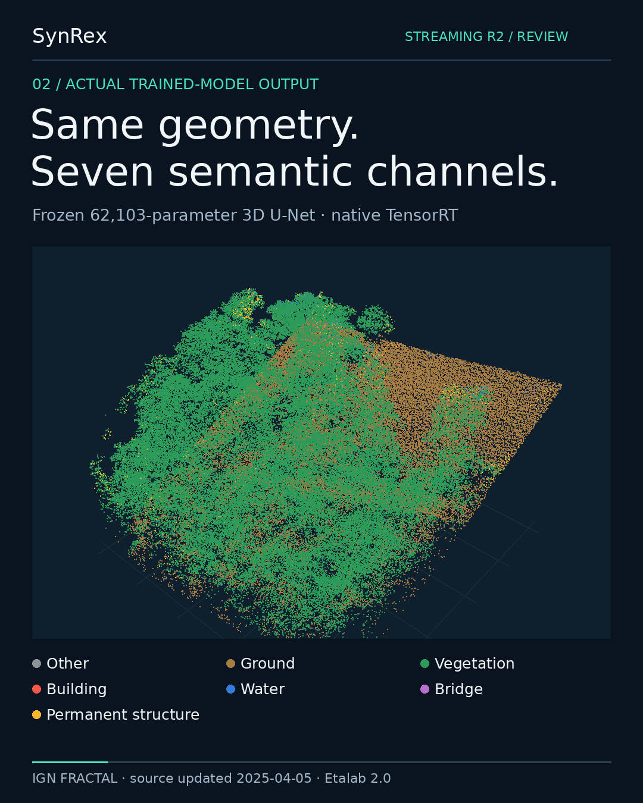
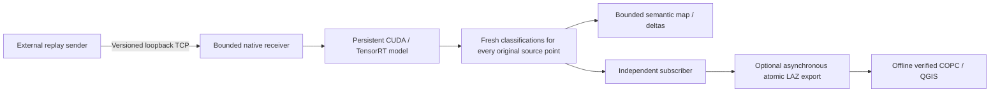

> **PUBLIC RESEARCH PRERELEASE — Streaming R2 RC4**  
> [Release, verified assets and 37-second video](https://github.com/Juurikko/synrex-jetson-lidar-edge/releases/tag/streaming-r2-rc4) ·
> [Quickstart](docs/publication/QUICKSTART_RC4.md) ·
> [Reproducibility / rights audit](docs/publication/PUBLICATION_AUDIT.md)  
> Qualified RTX 4090 *software replay*; no physical UAV, sensor, AGX Orin or Thor measurement.
> The current releases are measured on RTX 4090. An earlier, separate SegFormer 3D file
> pipeline was measured on a physical Jetson AGX Orin ([historical benchmark](archive/history/BENCHMARK.md));
> its non-commercial model is not distributed, and the streaming runtime is not yet ported to Jetson.

# SynRex Native LiDAR Streaming

<!-- Copyright (c) 2026 Tuomas Pietilä. SPDX-License-Identifier: CC-BY-4.0. -->

**Native C++17 / CUDA / TensorRT inference, original-point outputs and a bounded semantic map.**
Developer and project lead: **Tuomas Pietilä** ([@Juurikko](https://github.com/Juurikko));
engineering with OpenAI Codex assistance.

**Streaming R2 RC4 was publicly released on 2026-10-27 (UTC)** as a
[research prerelease](https://github.com/Juurikko/synrex-jetson-lidar-edge/releases/tag/streaming-r2-rc4).
The [R4 RC2 BYOM foundation](https://github.com/Juurikko/synrex-jetson-lidar-edge/releases/tag/byom-unet-fractal-r4-rc2)
(file-to-file classification, with its own README at that tag) remains a separately
preserved release.

### Start here

Large qualification receipts, historical reports and editorial drafts are grouped
under [archive/](archive/). Linux checkouts retain the original
`evidence/` runtime path through a relative symbolic link; browse GitHub receipts via
[archive/evidence/](archive/evidence/). For the **exact independently qualified public
snapshot**, use the immutable [`streaming-r2-rc4` tag](https://github.com/Juurikko/synrex-jetson-lidar-edge/tree/streaming-r2-rc4)
and matching release assets; this post-release layout is not a new benchmark or
reconstruction qualification.

- **Native streaming implementation:** [C++/CUDA/TensorRT runtime](native/) · [BYOM foundation](src/)
- **Build and replay:** [public quickstart](docs/publication/QUICKSTART_RC4.md) · [runtime commands](docs/streaming/STREAMING_R1_RUNTIME.md)
- **What the measurements mean:** [qualification report](docs/streaming/STREAMING_R1_QUALIFICATION.md) · [trial CSV](archive/evidence/streaming_r1_transport_trials.csv)
- **Full audit trail:** [archived verification receipts](archive/evidence/) · [separate public audit download](https://github.com/Juurikko/synrex-jetson-lidar-edge/releases/tag/streaming-r2-rc4)

IGN/FRACTAL LiDAR, source updated 2025-04-05, retrieved 2026-10-26, Etalab 2.0.
Colours are actual native model predictions, including mistakes. Camera placement is
illustrative. The source/model/event hashes and visual decimation are documented in the
[media provenance report](docs/streaming/STREAMING_R2_MEDIA.md).

The native inference process uses no Python or PyTorch. A model package is verified and
loaded once; the CUDA stream, TensorRT context and buffers persist across windows.
The analytic Conv3D fixture and frozen seven-class FRACTAL U-Net run through the same
binary and `DENSE_VOXEL_SEGMENTATION_V1` adapter. Python supports reproducibility,
independent validation, media rendering and optional offline COPC export.

## Qualified RTX 4090 replay results

These are **bounded, scene- and model-specific software replay measurements** with the
small, frozen 62,103-parameter U-Net. They are not physical sensor, larger-model, Orin or
Thor results. Incoming pacing targets, fresh neural classifications, map observations,
changed-voxel deltas and file-encoding rates are separate quantities.

| External native TCP workload | Accepted result |
|---|---|
| Scene A, stable, two 60-second runs | Approximately **2M freshly classified source points/s**, with map observations |
| Dense scene C, two 60-second runs | Approximately **1.5M/s**, with map observations |
| Full churn, 4,096 or 65,536 cells, two 60-second runs each | Approximately **1.5M/s**, with map observations |
| Ten-minute 65,536-cell full-churn replay | **600,014,848** fresh points / 600.026 s; **999,981/s** |
| Ten-minute coverage / drops / p99 replay-to-validated-output latency | **100% / zero / 39.85 ms** |
| Dense/churn TCP trials at 2M/s | **FAIL**: bounded output-delivery queue; failures retained |

**What the replay source is.** Each workload replays one finite licensed FRACTAL tile in a
loop, in 16,384-point frames. Scene A
([`TEST-0447_6390-002819414.laz`](docs/streaming/SUSTAINED_RTX_REPORT.md)) has 50,096
records, so at 2M points/s the same records repeat about 40 times per second; dense scene C
has 400,654 records. Full-churn runs, including the ten-minute run, loop scene A and shift
each successive frame by 64 m in x, so the map keeps receiving new cells while the point
attributes repeat. Rates are therefore pipeline throughput on repeated input, not a count
of distinct points. Accuracy at streaming-window context has not been evaluated separately;
the mIoU below comes from whole-tile processing.

Every counted classification comes from fresh neural execution. Map state never supplies
cached point labels. The original gates remain 250 ms p99 validated latency, 50 ms maximum
scheduling lag, two frames per queue, complete coverage and bounded memory.
[Exact R1 receipts and limits](docs/streaming/STREAMING_R1_QUALIFICATION.md) ·
[R2 independent audit](docs/streaming/STREAMING_R2_AUDIT.md).

Earlier **in-process** qualification reached approximately 3M/s on A/B, 2.5M/s on dense C
and 2M/s in full churn. Those boundaries exclude external TCP/subscriber work and must not
be substituted for the table above. Prepared-block model-only measurements emit **zero
source points** and are not complete classification throughput.

## Model quality and semantic contract

The separately frozen 256-tile / 24,902,618-point evaluation measured **48.756% seven-class
mIoU**, 60.585% macro-F1 and 90.814% overall accuracy. Rare-class accuracy is limited;
performance does not establish survey quality. The media includes genuine mistakes.
[Per-class quality and original evaluation](docs/byom/UNET_R2_RELEASE.md).

Semantic IDs 0–6 remain **other, ground, vegetation, building, water, bridge and permanent
aboveground structure**. They are distinct from the explicit LAS projection
`[1, 2, 200, 6, 9, 17, 201]`; 200/201 are custom conventions. Source identities,
measurement timestamps, supplied intensity/returns and complete frame boundaries survive
classification. There is no implicit georeferencing, pose estimation or physical capture.

The map uses 1 m cells in the qualified configuration, a bounded intrusive eviction index
and the frozen last-accepted-observation revision policy. Older observations of an
existing cell are rejected; equal timestamps refresh eviction ordering. There is **no
TTL expiration or calibrated confidence**. Full snapshots are explicit O(N) operations.

## Build, replay and inspect

Start with the [public reconstruction and two-model guide](docs/streaming/STREAMING_R2_REPRODUCIBILITY.md).
It covers a CPU build without CUDA, sanitizer tests, allocated-RTX checks, a separate
GPU build, sender/receiver/subscriber commands, source-indexed output verification,
optional export and media reconstruction. Public dependencies are external and pinned.

- [Versioned binary protocol](docs/streaming/STREAMING_R1_PROTOCOL.md)
- [Runtime and command-line examples](docs/streaming/STREAMING_R1_RUNTIME.md)
- [CPU eviction design](docs/streaming/CPU_EVICTION_INDEX.md)
- [Performance protocol](docs/streaming/SUSTAINED_PROTOCOL.md)
- [Atomic streaming export](tools/streaming_export.py) and [verified QGIS COPC path](docs/byom/QGIS_R4.md)
- [Separate ARM64/Orin/Thor continuation](docs/streaming/STREAMING_R1_PORTING.md)
- [R2 release notes and review package](docs/streaming/STREAMING_R2_RELEASE.md)

The receiver defaults to loopback. R1 supports one ordered producer identity and one
subscriber, bounded clean reconnects and explicit fail-closed output backpressure. It
does not provide authenticated remote transport, late-join resumption, a vendor UDP
adapter, SLAM or physical sensor qualification. Native file input remains compressed
LAS 1.4 PDRF 6/7/8 with the qualified layout; COPC is a separate viewing/export derivative.
The known QGIS direct 48-byte LAZ importer failure remains documented: use verified COPC.

## Rights and release identities

Qualified native source: **`f39fa29`**. Accepted R1 evidence seal: **`14bcb4f`**.
R2 adds audit, presentation, packaging and reproducibility tooling; it changes no native
runtime source, model weights, preprocessing or accepted benchmark output.

Original independently licensable source is **MIT**, bounded by
[LICENSE_SCOPE.json](LICENSE_SCOPE.json). Documentation/original presentation is CC BY 4.0;
IGN data is Etalab 2.0. Learned weights, upstream architecture, NVIDIA dependencies and
QGIS/Qt have separate notices. Model/data binaries belong in release assets, not normal
Git history. See [complete R2 rights/provenance](docs/streaming/STREAMING_R2_RIGHTS.md),
[third-party notices](THIRD_PARTY_NOTICES.md) and
[design-informed source provenance](docs/byom/PROVENANCE_REVIEW_R1.md).
No restricted private implementation or pretrained checkpoint is imported; no clean-room
claim is made. Physical sensor, AGX Orin and Thor qualification remain **NOT_RUN**.
