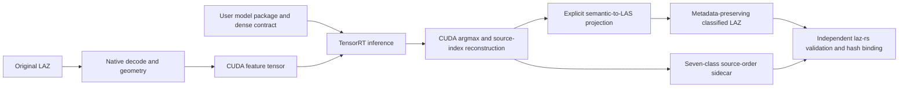

# SynRex Native LiDAR: two models, one explicit BYOM runtime

<!-- Copyright (c) 2026 Tuomas Pietilä. SPDX-License-Identifier: CC-BY-4.0. -->

**Local GitHub presentation draft — not published.** Developer and project lead:
**Tuomas Pietilä**. AI-assisted engineering with OpenAI Codex. Publication, pushes,
release uploads and visibility changes require explicit owner approval.

SynRex classifies LiDAR through native C++/CUDA/TensorRT, with no Python or
PyTorch dependency in the classification execution path. A versioned `.srxmodel`
package provides a validated tensor contract, target identity, explicit LAS
mapping, model/licensing notice and SHA256-verified artifacts. Switching between
two genuinely executed models requires a package change, not recompilation.

The supported adapter is `DENSE_VOXEL_SEGMENTATION_V1`, with configurable
names/shapes/types, voxels/features/normalization, blocks/overlap, class count and
LAS lookup. This is explicit dense compatibility, not arbitrary ONNX or sparse
transformer support. Dynamic shapes, plugins and sparse adapters are outside R0.

| Interchangeable model | Purpose | Executed evidence |
|---|---|---|
| Original analytic Conv3D | Deterministic nonconstant engineering fixture; no pretrained weights | Genuine TensorRT/CUDA,50,013 points and independent oracle |
| Compact MIT-attributed 3D U-Net | Seven-class airborne LiDAR segmentation;62,103 parameters, channels8/16/32 | Frozen held-out256 FRACTAL tiles,24,902,618 original points |

The U-Net uses occupancy, count/16, local height/32 and intensity/65535 on32³
one-metre voxels. Source/reference classification and RGB/NIR never enter inference
features. Every actual CUDA input tensor was independently checked. Erasing source
classification labels does not change neural predictions. Occupied-voxel
supervision and class balancing were frozen before fresh test access.

Native FP16 point mIoU is **48.756%**, macro-F1 **60.585%**, accuracy **90.814%**.
Geometry and majority baselines have macro-F1 **20.181%** and **10.234%**. All seven
classes occur in the test; bridge/other recognition remains weak. FP16 differs
from PyTorch FP32 on7,917 points (agreement99.968208%); rare classes are more
sensitive, with bridge IoU0.163 percentage points lower. These are measured
engineering results on a bounded subset, not production accuracy or full-benchmark
state-of-the-art claims. The consumed test is not used for further tuning.

[Actual four-scene application analysis](PERFORMANCE_R3.md) gives **237,991
complete-process points/s aggregated** on RTX4090. Largest real scene400,654
points takes990ms mean launch-to-exit, versus1.400ms TRT inference. Cold startup
and LAZ I/O are the current bottlenecks. Persistent processing69.830Mpoints/s
excludes cached geometry and LAZ I/O, so it is not application throughput.
Historical SegFormer3D AGX rates210,318 points/s largest and158,229 aggregated
use different hardware/model/data/representation/timing and are not a controlled
comparison. **New physical AGX BYOM inference is NOT_RUN**: Spatial Lab owns the
supervisor/GPU allocation. No project was interrupted or stack changed.

All256 native outputs pass independent source order, every nonclassification
record byte and supported metadata verification. Full semantic IDs0–6 remain
in a source/model/output-hash-bound sidecar. Aggregate vegetation uses documented
user-defined LAS200; permanent structure uses201. IGN bridge ID5 projects to
LAS17 bridge deck without claiming bridge-subcomponent accuracy. Sidecars are
authoritative; aggregate vegetation is not mislabeled standard high vegetation.

Actual Windows QGIS testing, project/style packages, genuine application captures
and exact scope/known direct-LAZ limitations are documented in
[QGIS interoperability](QGIS_R3.md). Viewing derivatives, where used, remain
separate from the immutable native outputs. They do not enlarge the native input
contract to COPC. No screenshot is synthetic or produced by generative imaging.

Original runtime/training/export/verification source: **MIT**. Architecture:
[pytorch-3dunet](https://github.com/wolny/pytorch-3dunet) by Adrian Wolny, MIT,
pinned and attributed. New weights were trained from scratch, without restricted
pretrained assets, and are offered under MIT with IGN source/date attribution.
Real survey information: [IGNF/FRACTAL](https://huggingface.co/datasets/IGNF/FRACTAL),
**Etalab2.0**, source latest update2025-04-05, retrieved2026-10-26. NVIDIA plans/SDK
retain vendor terms; Apache2 codec and all other third-party notices remain
separate. QGIS/Qt interface imagery retains upstream rights; only original
presentation is CC-BY4.0. The provenance assessment discloses earlier private
source exposure and makes no clean-room or independent legal-clearance claim.

Reproduce with the [frozen quickstart](UNET_R2_QUICKSTART.md),
[clean reconstruction evidence](../../archive/evidence/unet_r3_clean_reconstruction.json),
[full R2 qualification](UNET_R2_RELEASE.md),
[licence/weight lineage](UNET_PROVENANCE.md) and the local release receipts.
RC2 at `f8d3ab81804e0c427684ac08f1b055e75206b861` and audit commit `e3fcb82`
remain traceable and unchanged. R3 adds analysis/interoperability/publication
preparation, not new trained weights or tuned test predictions.

Streaming inference and LitePT-S/TorchSparse++ remain separate future milestones,
with their own contracts and qualification. Neither is implied by these dense
model results.
