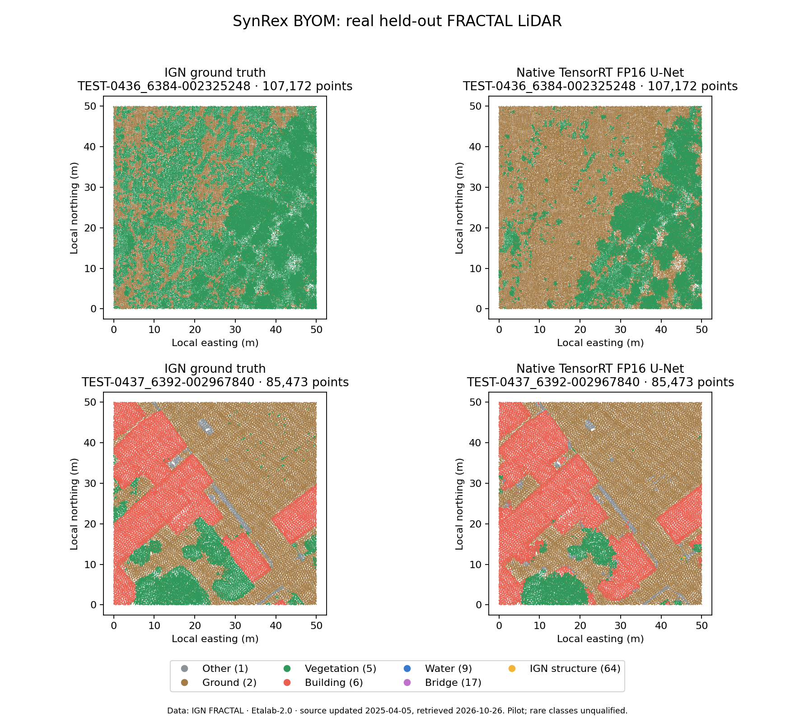

# Trained dense U-Net: RTX4090 qualification

<!-- Copyright (c) 2026 Tuomas Pietilä. SPDX-License-Identifier: CC-BY-4.0. -->

**PASS for the bounded real-data pilot.** This is a second genuinely trained model
running through `DENSE_VOXEL_SEGMENTATION_V1`, alongside the original analytic
Conv3D. No model-specific C++ inference, feature or reconstruction code was added.
Physical AGX execution is **NOT_RUN**. Publication is held for owner approval.

Qualified source: `dc3f3630dc72c2c76139787bd4dfd7c09a1e0e42`. Runtime implementation
was built from ancestor `61c60ae`; later commits through this qualification only
changed training, validation, notices and documentation. The qualified binary SHA256
is `e14ee5b059c8c266398ee7f7560f3204f6fe5b956eb3aa832d38d3757faba334`.
That hash was unchanged before and after executing both models. The accepted
`eaf3ce2` checkpoint remains in history. Exact commits were transferred by Git bundle,
never pushed to GitHub. All following evidence records executed work on 2026-10-26.

## Model, data and training

Authentic MIT `pytorch-3dunet` UNet3D, pinned source, DoubleConv, three encoder
levels `[8,16,32]`, Conv/BatchNorm/ReLU, max pooling, nearest-neighbor decoder,
no dropout or final activation: **62,103 learned parameters**. All parameters were
initialized from scratch, seed 20261026; no pretrained model or restricted source
was used. See [source/data rights](UNET_PROVENANCE.md) and
[dependency identities](../../evidence/unet_dependency_lock.json).

The pilot uses 256/32/32 fixed train/validation/test tiles from FRACTAL split archive
00, containing 20,711,690 / 1,962,809 / **2,586,115** points. The test region is
held out by the official split. No positive-area XY bounding-box overlap exists
between any pilot splits. The test split was never loaded by training; validation
mean IoU selected epoch 52 of 60. No test-driven retraining occurred. The deterministic
display selection below was performed after qualification and did not select the model.

Inputs are `[1,4,32,32,32]`, outputs `[1,7,32,32,32]`, NCZYX, FP16. Voxels are 1 m,
blocks 32 m on each axis, zero overlap, first_wins. Features are occupancy, count/16,
mean local Z/32 and mean measured intensity/65535. The origin is the cloud minimum,
not a ground-truth terrain surface. Empty voxels stay zero. Training voxel targets
are majority semantic class, lowest-index tie; empty/artifact-only voxels are ignored.
Horizontal rotations/reflections preserve these scalar features. Native classification
uses no augmentation, sampling or label-derived input feature.

AdamW, learning rate 0.003 to 0.0001 cosine schedule, batch 8, class-weighted cross
entropy, 60 epochs. There were 1,097 nontrivial training and 130 validation blocks.
The training/export timer was **94.894 s**, excluding initial data loading. Peak
PyTorch allocation was 148,917,760 bytes and reservation 287,309,824 bytes.
Training is seeded but not promised bitwise repeatable: PyTorch 2.9 lacks deterministic
CUDA MaxPool3d backward. The initial strict-determinism failures were retained locally;
the successful run explicitly uses warn_only with deterministic cuDNN selection.
Native inference repeatability is independently verified below.

## Held-out quality and numerical agreement

**Point accuracy: 91.1042%; ground/vegetation/building mean IoU: 82.0778%.**
Training-majority baseline accuracy is 51.6517%. Voxel-collision upper-bound point
accuracy is 97.4074%, illustrating the limitation of 1 m voxel reconstruction.
Quality gate, declared before the test run: common-three mean IoU >=50% and point
accuracy > training-majority baseline +10 percentage points. Both passed.

| Channel | LAS code / meaning | Scored real test points | IoU |
|---|---|---:|---:|
| 0 | 1 other | 11,900 | 21.91% |
| 1 | 2 ground | 1,151,707 | 85.22% |
| 2 | 5 vegetation, including source 3/4 | 1,335,692 | 83.91% |
| 3 | 6 building | 83,432 | 77.11% |
| 4 | 9 water | 0 | 0%, false positives; no ground-truth water support |
| 5 | 17 bridge | 2,953 | **0%** |
| 6 | 64 IGN permanent structure | 275 | 58.89%, very small support |

Seven-output-class mean IoU is **46.7185%**, including false-positive-only water.
Unknown/sensor-artifact labels 65/66 are excluded from scoring (156 points), but
all their source records remain in output and receive predictions. This pilot
does not qualify rare-class performance, full-FRACTAL accuracy or survey reliability.
Code 64 is an explicit IGN application convention. The model is useful engineering
evidence of learned real semantics, with the failures above visible rather than hidden.

FP32 PyTorch versus ONNX Runtime CPU maximum logit difference was **0.0000451**.
Across all 130 test blocks (29,818,880 logits), TensorRT FP16 versus FP32 PyTorch:
RMSE **0.0196251**, maximum absolute error **0.340981**, point-label agreement
**99.973435%** (687 differences). Gate: FP32 export max error <0.001, FP16 RMSE
<0.03, point-label agreement >=99.5%. The FP16 path includes feature quantization.
FP32/FP16 accuracy differs by 0.008585 percentage points; common-three mean IoU
differs by 0.030904 percentage points. FP16 is numerically close, not bit-identical.

## Genuine native execution and integrity

The exported FP16 ONNX was parsed by TensorRT 10.16.1.11, compiled using the generic
`--precision fp16` policy, deserialized, and inspected for actual Half layer tensors.
The target-specific engine is 263,428 bytes. Every native `enqueueV3` completed,
with positive CUDA preparation/inference/postprocessing event timings.

Every native prediction on all 2,586,115 points exactly matches a separately
executed TensorRT oracle using independently prepared NumPy tensors. The oracle's
Python/PyTorch process is separate from classification. Every native test-file
invocation used `PATH=/nonexistent`, empty PYTHONPATH, and loader diagnostics;
none loaded libpython or libtorch. The first real tile was repeated in a fresh
process with identical labels and classified-LAZ bytes. Three further isolated
benchmark runs also produced identical outputs. The original 50,013-point Conv3D
fixture then passed through the same unchanged binary and its independent oracle.

Independent laz-rs checks passed on the RTX4090 target and again on i5radeon after
download: exact source point order, every unrelated decompressed record byte,
public header, non-LASzip VLRs and metadata padding. These are real PDRF8/38-byte
source files, not converted synthetic fixtures. The extended writer also passes
PDRF6/7/8 tests, extra bytes and a 50,013-record chunk-boundary fixture.

Full RTX4090 regression: **62 PASS, 1 SKIP**, the CPU-only-build rejection test.
The four genuine GPU cases cover FP16/FP32, differing grids, overlap policies,
measured intensity, relocated inference and negatives. CPU: **59 PASS, 4 GPU SKIP**,
plus native CTest PASS. Bad hashes, tensor names/shapes, targets, class maps,
engine bytes, unsupported inputs and output overwrites reject. No CPU inference
fallback exists.

## Latency, throughput and memory

RTX4090-Wsl, SM89, same user-space CUDA 13.2/TensorRT 10.16 qualification dependencies
as the original run; training separately uses PyTorch 2.9.1+cu128. No stack, driver,
clock or power settings changed. Preflight found no competing compute process and
0% utilization. Existing Torch packages were reused read-only in a new venv.
No AGX connection or workload modification occurred.

| Stage | Mean per real test file, ms (32 files) |
|---|---:|
| CPU LAZ decode | 31.678 |
| CPU geometry | 10.956 |
| CPU preprocessing total | 42.633 |
| CUDA tensor preparation | 1.582 |
| TensorRT inference | 1.052 |
| CUDA postprocessing | 0.0271 |
| Native LAZ encoding/preservation | 53.864 |
| GPU initialization/initial upload | 199.282 |
| Complete invocation | **303.675** |

Aggregate end-to-end throughput: **266,127 points/s**, including fresh per-file
initialization and output hashing. CUDA events measure actual stream stage
intervals; CPU/end-to-end timings use monotonic wall time. Rows overlap and are
not additive. Loader diagnostics were enabled for these qualification invocations.
No historical SegFormer measurement contributes to any number here.

For a separate 107,172-point tile, three fresh native invocations with memory
sampling took 412.676 / 377.525 / 384.685 ms. Sampled device usage was **516 MiB**
against a **130 MiB** idle desktop baseline: observed increase 386 MiB. These are
device-wide nvidia-smi samples, **not exact allocator peak memory**. cudaMemGetInfo
snapshots across all file runs showed 42–48 MiB reduction from before engine
initialization to after adapter allocation; those device-wide snapshots exclude
earlier CUDA context initialization and do not establish a peak either. Training
allocator peaks are separately reported above.

## Reproducibility and review artifacts

- [Exact data members/CRCs/SHA256s](../../evidence/unet_dataset.json),
  [split validation](../../evidence/unet_split_validation.json).
- [Training receipt](../../evidence/unet_training.json),
  [all epochs](../../evidence/unet_training_history.json),
  [development environment](../../evidence/unet_python_environment.json).
- [GPU qualification and all 32 file receipts](../../evidence/unet_rtx4090_qualification.json),
  [engine layer inspection](../../evidence/unet_engine_build.json),
  [post-download independent verification](../../evidence/unet_download_validation.json).
- [Full GPU suite](../../evidence/unet_full_suite.json),
  [native timing/memory samples](../../evidence/unet_native_benchmark.json).

See [reproducible quickstart](UNET_QUICKSTART.md), [AGX plan](AGX_QUALIFICATION_PLAN.md)
and the separate [LitePT/TorchSparse investigation](LITEPT_SPARSE_PLAN.md).

The first sorted test tile and tile with the most building points are displayed,
using every point in increasing elevation order, without interpolation or smoothing.
The first tile makes low-vegetation/ground confusion visible. Metrics include all
32 tiles, not just this display selection. Data: IGN FRACTAL, Etalab-2.0, source
last updated 2025-04-05, retrieved 2026-10-26; original presentation CC BY 4.0.
