# Streaming R1 native runtime

<!-- Copyright (c) 2026 Tuomas Pietilä. SPDX-License-Identifier: CC-BY-4.0. -->

R1 continues accepted `fe21303` without rewriting R4 or R0 evidence. The
[baseline freeze](../../evidence/streaming_r1_baseline_freeze.json) includes every historical
receipt and accepted streaming report. Track B remains local and unpublished. All new native
code is independently authored against the public MIT APIs; third-party SDKs, trained model
and IGN/FRACTAL Etalab data retain their separate notices. No private source is imported.

```mermaid
flowchart LR
    P[External native replay producer] -->|bounded binary TCP / loopback| R[Receiver and validator]
    R -->|two complete frames| N[Persistent CUDA / TensorRT worker]
    N -->|two classified frames| M[Indexed semantic map and binary event construction]
    M -->|two delivery frames / reject and disconnect on overflow| W[Socket writer]
    W --> S[External native subscriber]
    S --> V[Independent point and map oracle]
    S -->|optional bounded first-observation product| E[LAZ worker]
    E --> B[Atomic complete bundle]
    B --> C[Optional offline verified R4 COPC / QGIS exporter]
```



Wire scalar checks construct diagnostic strings only on failure. `Sequence::decode_frame`
and `decode_classified` fully validate each wire record once, then apply ordering checks before
returning it; direct C++ `accept` still validates its input. The subscriber keeps the independent
hash/list oracle for every delta and the final exact snapshot. It avoids a second ordered
occupancy tree; in-process tests still compare actual resident size at every update. Use
`--validation-mode reference` to retain duplicate sequence validation and the second tree for
matched comparisons. All numerical, identity, timestamp and capacity checks remain active.

`Service` retains exactly one model verification/deserialization/context/stream per receiver.
Every accepted complete frame calls the trained model. Successful TensorRT enqueue counts,
completed windows and freshly reconstructed point counts are independently reconciled at end.
The map never supplies inference labels. Semantic IDs remain separate from LAS projection.
Socket delivery counts and failures are separate from neural classification counters.

The protocol, limits, coordinate domains and clock meanings are specified in
[the v2 wire contract](STREAMING_R1_PROTOCOL.md). Input and output use different loopback TCP
ports. Complete messages and partial socket reads have explicit byte/count/deadline limits.
Input overload fails visibly. Output subscribers have their own two-frame queue and absolute
send deadlines; delivery failure disconnects the subscriber while classification can continue.
A passing rate requires complete independent subscriber coverage, not successful enqueue alone.
Clean reconnects preserve sequence/identity state. Truncated input fails closed. Multiple sensors
use distinct sessions/maps and distinct port pairs; shared-map fusion requires an explicit
future pose-aware interface. A changed identity on an existing session rejects.

R1 adds an optional stable radix member ordering strategy. It leaves assignment, boundary
fallback, block grouping, origins, voxel arithmetic and block order unchanged. Records arrive
in source-index order, so stable byte-wise voxel sorting produces the reference `(voxel, point)`
order exactly. Scratch is one bounded block vector plus 256 offsets; blocks below 256 members
retain comparison sorting. Nonzero overlap uses the original reference implementation.
`reference`, accepted `direct`, unsuccessful historical `flat`, and optional `radix` remain
selectable. This changes no floating-point reduction order. GPU preparation, inference, scatter,
weights and package contracts are unchanged. Pinned staging stays disabled.

The GPU timeline uses the existing persistent CUDA events, host block issue timings and window
wall clock. H2D/zero event intervals include issue gaps and cannot be interpreted as pure PCIe
bandwidth. CPU geometry, command issue, synchronization, inference and map sink can overlap
across frames; active service durations cannot be summed into wall latency. Synchronizations
currently protect the lifetime of per-block host upload vectors. Removing them needs a separate
owned-staging design and new parity evidence; R1 does not silently remove those lifetime fences.

The optional LAZ exporter runs in the subscriber process on a separate thread. It retains at most
one source corpus (up to one million records), one set of seen/label/provenance arrays and one
complete product job. First observations are selected by original source-record ID. Repeated
observations never create unbounded export jobs. All geometry/intensity must match the bound
original source; spatially transformed churn cannot be written onto unrelated original records.
Partial source coverage never publishes. A complete bundle contains preservation-writer LAZ,
original-record-order semantic IDs, labels, measurement/frame provenance, taxonomy/CRS declarations
and exact source/model/file hashes. A private sibling staging directory is synchronized and
published with Linux `renameat2(RENAME_NOREPLACE)`. Existing products cannot be replaced. A
hard-killed process may leave a hidden staging directory; it is never a complete product.

`tools/streaming_export.py` independently verifies those products using unchanged R4 preservation
and semantic validators. Optional COPC conversion reuses R4's verified source-index/semantic
mapping, PDAL and QGIS project checks, behind a second atomic directory publication. This is an
offline consumer, not a production inference dependency. Actual COPC encoding requires the
already installed external tools and receives its own qualification status.

Build with the R4 dependency set and ordinary CMake flags. `synrex-live` and CPU wire/export tests
build without CUDA; a CPU receiver fails closed rather than simulating inference. RTX inference
requires the frozen target-specific packages, an available allocation and SM89 CUDA/TensorRT.
No new external dependency is introduced beyond POSIX/Linux sockets and existing OpenSSL.

Example after verifying an idle allocation, using new receipt paths:

```bash
build-gpu/synrex-live receive --model "$UNET" --receipt receiver.json \
  --port 39181 --output-port 39182 --points 16384 --map-cells 65536 \
  --geometry radix --rate 1000000 --warmup 5
# In a second terminal, start the independent subscriber before the producer.
build-gpu/synrex-live subscribe --model "$UNET" --source "$SCENE" \
  --receipt subscriber.json --rate 1000000 --seconds 60 --warmup 5
# In a third terminal:
build-gpu/synrex-live send --model "$UNET" --source "$SCENE" \
  --receipt sender.json --rate 1000000 --seconds 60 --warmup 5
```

For arbitrary external input, omit `--source` from the subscriber; it still validates model
binding, identity, classifications, every map delta and the final snapshot. Without a replay
clock, physical sensor age is unavailable rather than synthesized. The transform C++ API
requires a versioned, rigid, explicitly timed pose; missing or invalid transforms reject.
Use `--export-bundle NEW_DIRECTORY --taxonomy examples/unet/semantic_classes.json` on a source-bound
subscriber for optional LAZ. `--export-after-frame` can defer export collection into measurement.

```bash
ctest --test-dir build --output-on-failure
python -m pytest -q tests/test_streaming_r1.py
python tools/streaming_export.py --bundle "$BUNDLE" --source "$SCENE" \
  --model "$UNET" --taxonomy examples/unet/semantic_classes.json
python tools/streaming_r1_campaign.py --native-dir "$BUILD" --baseline-dir "$FROZEN_BUILD" \
  --model "$UNET" --synthetic-model "$CONV3D" --sources "$A" "$B" "$C" \
  --source-commit "$SOURCE_COMMIT" --phase smoke --out "$NEW_OUTPUT"
# Sequential phases: geometry, transport, faults, exports; long only after sustained PASS.
```

The controller checks Linux and Windows GPU workload state before each trial and samples owned
process RSS, device memory, utilization, clocks and power during execution. It terminates only
its own processes on a correctness/resource/time bound. Accepted sustained gates remain 250 ms
p99 at the subscriber, 50 ms producer scheduling lag, two-frame queues, one GiB host/4 GiB GPU
limits and 64 MiB measured receiver RSS variation. Long tests are bounded at 600–1,800 seconds.
Native FAIL receipts remain FAIL even when the fault harness correctly observes them.

Orin and Thor each require native ARM64 dependencies, target-compatible TensorRT, a new target
engine built from the frozen ONNX and independent numerical/latency/resource qualification.
Use the existing SM87 and SM110 CMake target gates; Linux transport/export APIs are native ARM64
compatible in design but target compilation is NOT_RUN until physically tested. RTX serialized
engines cannot qualify either target. AGX/Thor are untouched, and sparse adapters remain separate.
